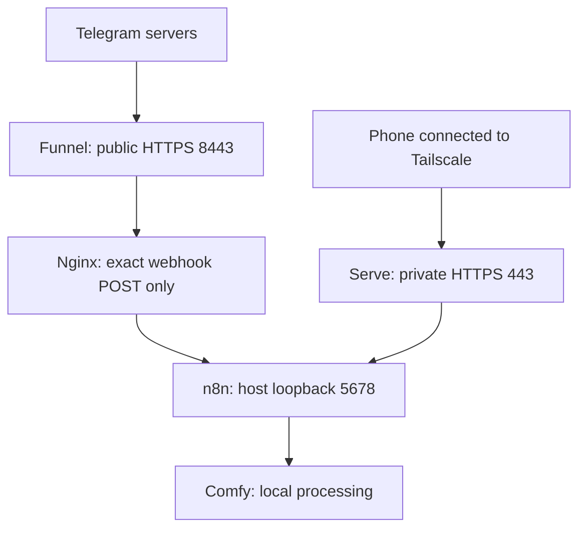

# Remote access: Tailscale, Telegram, and the n8n gateway

This guide documents the operator's actual Windows/Docker Desktop routing, with personal domains and webhook IDs removed. Processing and storage are local, but Telegram messaging and its webhook transport depend on external services and Internet connectivity.

Tailscale is the reference deployment's remote-access solution, not a required license or component of the video models. Another HTTPS ingress/private-access solution could replace it, but must preserve the same application and exposure boundaries.

## 1. Two separate entry paths

| Purpose | Outside address | Host target | Next hop |
|---|---|---|---|
| Private editor and approval forms | https://desktop.tailXXXXX.ts.net on 443 | 127.0.0.1:5678 | n8n container port 5678 |
| Public Telegram updates | https://desktop.tailXXXXX.ts.net:8443 | 127.0.0.1:5680 | Nginx container port 8080 → host.docker.internal:5678 → n8n |



Telegram servers do not join the tailnet. Funnel provides their public HTTPS destination. Your phone uses the private tailnet path to reach the editor and signed review form.

The same hostname is used with different ports/exposure. Serve 443 and Funnel 8443 are not interchangeable. Do not make 443 public merely because the bot uses the same hostname. The whole root on 8443 reaches Nginx, so its default-deny rule is essential.

## 2. Evidence and validation boundary

The operator supplied:

- Tailscale 1.104.2 and serve/funnel status showing private 443 → 5678 and public 8443 → 5680.
- n8n image docker.n8n.io/n8nio/n8n:2.43.7, host bind 127.0.0.1:5678 → container 5678.
- Gateway image nginx:stable-alpine, host bind 127.0.0.1:5680 → container 8080.
- An active Nginx configuration for which nginx -T reported successful syntax validation.
- n8n URL settings listed below.

The Nginx image tag is mutable; its exact version/digest was not supplied. The sample Compose file reconstructs the observed ports/image/config mount, not an independently verified export of the operator's complete Compose configuration. This guide is not a fresh installation test or a live public-endpoint security audit.

Existing operators publishing documentation do not need to rerun setup commands. Do not replace working Serve/Funnel rules, gateway containers, or production workflows merely to match an example.

## 3. URL and authentication settings

Sanitized n8n values for the observed topology:

```text
N8N_EDITOR_BASE_URL=https://desktop.tailXXXXX.ts.net/
N8N_WEBHOOK_URL=https://desktop.tailXXXXX.ts.net:8443/
N8N_HOST=desktop.tailXXXXX.ts.net
N8N_PROTOCOL=https
N8N_PORT=5678
N8N_PROXY_HOPS=1
```

Replace the example hostname with your own. Use no Markdown backticks or embedded spaces in actual environment values. The private UI/form base has no :8443; Telegram's public webhook base does.

N8N_PORT remains the internal application port. Tailscale terminates external HTTPS and proxies to the host-local HTTP service; changing external TLS ports is not a reason to change the internal container port.

The setup preparer's default lab host port is **5681**, not this deployment's **5678**. For that lab, adapt the private Serve target and Nginx upstream to the actual n8n host port. Do not connect an isolated lab bot to production n8n by accidentally retaining 5678. Tailscale hostname/port routes on one machine are shared configuration, not automatically isolated by Docker project names.

Keep the three application credentials separate:

- Native Telegram credential, selected on all Telegram nodes.
- LTX Start Auth / X-LTX-Token for the internal /webhook/start callers and receiver.
- External Comfy integration key for Bearer requests and X-N8N-Recovery-Key.

A signed approval form is reached through the private base in Send Review Link. Preserve its execution path/query; never put signed links into public examples. See SETUP.md for credential binding details.

### Why one proxy hop is coherent here

The public Nginx location deliberately replaces X-Forwarded-For with $remote_addr. It does not append the incoming chain. n8n therefore receives a single forwarded address from the gateway instead of the complete Funnel → Nginx client chain. In this observed public route, N8N_PROXY_HOPS=1 is coherent; counting every network component and automatically setting 2 would overlook that rewrite.

This does not recover or authenticate Telegram's original public IP. The visible address may be the preceding local/Docker forwarding hop. The private route goes through Serve directly; inspect its actual forwarded headers if changing the topology. Hops is a trust setting, not an authentication secret, and no universal value is asserted for other deployments.

## 4. What the Nginx configuration enforces

The sanitized template is [nginx.conf.template](../examples/telegram-ingress/nginx.conf.template).

| Rule | Behavior |
|---|---|
| Exact location = production Trigger path | Permits only that URI path to reach n8n |
| Method check | Non-POST to that location returns 405 |
| Default location | Every other path returns 404 |
| Request body limit | 64 KiB, for Telegram update JSON |
| Rate limit | 2 requests/second with burst 10 and 429 on excess |
| Upstream | n8n through host.docker.internal and the actual host port |
| Forwarded headers | Explicit host/protocol plus a replaced X-Forwarded-For |
| Upstream timeouts | Connect 5s; read/send 15s |
| Logs | Access log off; warning/error output on stderr |

The body limit is for update JSON, not the first-frame binary. The workflow downloads image data separately through Telegram's API. Do not increase the public ingress limit to the image-upload limit merely because images are supported.

Nginx passes original request headers by default. The supplied configuration does not disable that forwarding or replace X-Telegram-Bot-Api-Secret-Token. Preserve that header and confirm native Telegram Trigger's origin checks in the installed n8n version. An exact path, a rate limit, and a user/chat allowlist do not themselves authenticate the sender.

The limiter uses a shared key, not verified individual Telegram sender IPs. Heavy delivery bursts can receive 429. A slow or unavailable n8n can produce 502/504; Telegram may retry delivery, so preserve the application's duplicate/submission protections. The 15s timeout is for webhook acknowledgment, not for the 15-minute video generation. Do not make the webhook wait for sampling to finish.

These paths must remain outside the public allowlist: /, editor/API routes, /form-waiting/*, /webhook/start, /webhook/video-queue-reconcile, /webhook-test/*, and Comfy /n8n/jobs/*. Do not add a catch-all proxy as a workaround for 404.

## 5. Prepare private gateway files for a new installation

The reference [Compose example](../examples/telegram-ingress/compose.example.yaml) starts only Nginx. It does not install/configure n8n, authorize Funnel, create a tailnet, or set up DNS/certificates. Prerequisites: a Tailscale account/client on the host and phone, appropriate tailnet permissions/policy for HTTPS and Funnel, an authorized bot, and a configured n8n instance.

Keep generated files outside Git. For a new deployment, obtain the exact **Telegram Trigger → Production URL** from your configured workflow. Never use the internal LTX /webhook/start URL or the editor's test URL. Keep message and callback_query enabled. Use a separate bot if testing; one bot has one active webhook registration.

From the repository root, prepare a new destination only:

```powershell
$ErrorActionPreference = 'Stop'
$repoRoot = (Get-Location).Path
$gatewayRoot = 'E:\AI\services\telegram-ingress-example'
if (Test-Path -LiteralPath $gatewayRoot) {
    throw 'Destination already exists. Review it instead of overwriting.'
}
$triggerText = Read-Host 'Exact Telegram Trigger Production HTTPS URL'
$triggerUri = $null
if (-not [Uri]::TryCreate($triggerText, [UriKind]::Absolute, [ref]$triggerUri)) {
    throw 'Invalid absolute URL.'
}
if ($triggerUri.Scheme -ne 'https' -or $triggerUri.UserInfo -or $triggerUri.Query -or $triggerUri.Fragment) {
    throw 'Use an HTTPS production URL without credentials, query or fragment.'
}
$webhookPath = $triggerUri.AbsolutePath
if ($webhookPath -notmatch '^/webhook/[A-Za-z0-9_-]+/webhook$') {
    throw 'Expected the exact native Telegram Trigger production path. Do not broaden the rule.'
}
$n8nHostPort = Read-Host 'Actual n8n HOST port, e.g. 5678 or lab 5681'
if ($n8nHostPort -notmatch '^\d{1,5}$' -or [int]$n8nHostPort -lt 1024 -or [int]$n8nHostPort -gt 65535) {
    throw 'Invalid host port.'
}
$templatePath = Join-Path $repoRoot 'examples\telegram-ingress\nginx.conf.template'
$composePath = Join-Path $repoRoot 'examples\telegram-ingress\compose.example.yaml'
$template = Get-Content -Raw -Encoding UTF8 -LiteralPath $templatePath
$config = $template.Replace('__TELEGRAM_WEBHOOK_PATH__', $webhookPath).Replace(
    '__N8N_UPSTREAM_URL__', ('http://host.docker.internal:' + $n8nHostPort)
)
if ($config -match '__[A-Z0-9_]+__') { throw 'Unresolved template marker.' }
New-Item -ItemType Directory -Path $gatewayRoot | Out-Null
[IO.File]::WriteAllText((Join-Path $gatewayRoot 'nginx.conf'), $config, (New-Object Text.UTF8Encoding($false)))
Copy-Item -LiteralPath $composePath -Destination (Join-Path $gatewayRoot 'compose.yaml')
```

This example accepts the documented native Trigger path shape only. If a future n8n version changes it, investigate the actual generated route and adapt the exact-path validation deliberately. It never accepts an arbitrary Nginx directive or proxy URL as input. Ordinary Nginx $variables are preserved by reading the template literally rather than expanding it in a PowerShell here-string.

## 6. Validate and start a NEW gateway

Do not run this alongside the current production gateway on port 5680. The example matches its port intentionally; it is a setup reference, not a second service to start now.

```powershell
$gatewayCompose = Join-Path $gatewayRoot 'compose.yaml'
docker compose -p telegram-ingress-example -f $gatewayCompose config --quiet
if ($LASTEXITCODE -ne 0) { throw 'Compose validation failed.' }
docker compose -p telegram-ingress-example -f $gatewayCompose run --rm --no-deps telegram-gateway -t
if ($LASTEXITCODE -ne 0) { throw 'Nginx configuration validation failed.' }
docker compose -p telegram-ingress-example -f $gatewayCompose up -d
if ($LASTEXITCODE -ne 0) { throw 'Gateway startup failed.' }
```

The explicit nginx entrypoint allows the same service to run with -t during validation. nginx:stable-alpine is a mutable reference matching the reported deployment; record the selected version/digest if you need stronger reproducibility. Linux Docker needs its own host-reachability setup; this example assumes Windows Docker Desktop.

## 7. Tailscale routes for a new, reviewed installation

Read existing state before changing anything:

```powershell
tailscale version
tailscale serve status
tailscale funnel status
```

For a machine whose intended services/ports have been reviewed, these commands express the observed routing:

```powershell
tailscale serve --bg --https=443 http://127.0.0.1:5678
if ($LASTEXITCODE -ne 0) { throw 'Private Serve configuration failed.' }
tailscale funnel --bg --https=8443 http://127.0.0.1:5680
if ($LASTEXITCODE -ne 0) { throw 'Public Funnel configuration failed.' }
```

These commands **change host routing**. Adapt 5678 for the actual n8n host port; keep public forwarding directed at the restrictive gateway, not directly at n8n. Existing routes may be replaced or conflict, and Serve/Funnel cannot share the same exposure port simultaneously. Do not use reset commands to clear unrelated services. bg requests persistent background operation; host availability, permissions, and Tailscale connectivity still matter.

Follow the client's current enablement/authorization flow if HTTPS/Funnel is unavailable. Tailnet policy should grant Funnel access only to intended identities/devices; never paste your full access policy or authentication keys into a public issue. Tailnet access to private forms should also be restricted to intended users/devices. This project supplies no universal ACL replacement.

After configuration, check that 443 is tailnet-only and only 8443 has Funnel enabled. Publish/register the intended Telegram workflow when ready. If its Production URL path changes after recreation/import, update the private exact-location file and validate/reload the correct gateway deliberately; do not keep obsolete allowlist entries for convenience.

## 8. Checks and troubleshooting

Existing deployment read-only checks:

```powershell
tailscale serve status
tailscale funnel status
docker ps --format 'table {{.Names}}\t{{.Image}}\t{{.Ports}}'
# Substitute the actual gateway container name; this does not reload it.
docker exec YOUR_GATEWAY_CONTAINER nginx -T
```

Review nginx -T output before sharing: it contains the actual route and could contain literal headers in a customized installation. Never paste docker inspect, raw tokens, key files, or signed form links wholesale.

From an ordinary PowerShell session, harmless GET checks against the new gateway:

```powershell
curl.exe --silent --show-error --output NUL --write-out '%{http_code}\n' http://127.0.0.1:5680/
curl.exe --silent --show-error --output NUL --write-out '%{http_code}\n' ('http://127.0.0.1:5680' + $webhookPath)
```

Expected: 404 for / and 405 for GET to the exact permitted path. These are routing checks, not proof of public reachability or webhook authentication. Do not POST a fabricated update to a live bot merely as a connectivity probe.

| Symptom | Check |
|---|---|
| / returns 404 on public 8443 | Expected default deny; public ingress is not the editor |
| Exact path GET returns 405 | Expected; Telegram sends POST |
| Bot receives no updates | Actual registered Production URL, exact path, Funnel status, n8n reachability, callback event selection, and native Trigger credential |
| 502/504 | Gateway-to-n8n port/host path, backend health, acknowledgment latency |
| 429 | Shared request rate/burst; inspect duplicate bursts and capacity before changing limits |
| 413 | Update JSON exceeded 64 KiB; not the separate Telegram file download limit |
| Phone form fails but bot works | Private Tailscale connection, private base, signature, pending execution, no accidental :8443 or duplicate slash |
| Editor works but bot fails | Private access does not establish that public Funnel/allowlist is correct |
| Client IP differs from Telegram | X-Forwarded-For replacement intentionally loses the original chain; do not infer origin authentication from it |

Test public reachability from outside the tailnet using a nonsensitive GET to a blocked path, and test private approval with Tailscale enabled on your phone. A private route should not be publicly reachable. TLS/DNS errors are different from expected 404/405 responses. Actual bot delivery should be tested by a normal command through Telegram, without constructing a token-bearing API URL in a public log.

No test commands here submit GPU work. The topology review did not test spoofed webhook rejection or all tailnet policy permissions. Record what you actually verified instead of claiming a complete security audit.

## 9. Publishing and alternatives

Commit only this guide, the sanitized templates, and documentation links. Keep generated nginx.conf/compose files, real domains, webhook identifiers, tailnet policies/state, and secrets outside the repository. A webhook UUID is not a substitute for authentication; its removal here is export hygiene, not a claim that the pasted identifier is itself a leaked bot token.

A different HTTPS reverse proxy/tunnel can replace Funnel if it provides a Telegram-reachable production URL and preserves endpoint filtering and origin checks. Private UI/approval access still needs a deliberate solution. Another service is not automatically equivalent to this deployment's ports, headers, or trust boundaries.

This addition does not change production, enable CI/CD, require the maintainer to perform a clean installation, or move the published preview tag.

## Official references

- [Tailscale Serve](https://tailscale.com/docs/features/tailscale-serve)
- [Tailscale Serve CLI](https://tailscale.com/docs/reference/tailscale-cli/serve)
- [Tailscale Funnel CLI](https://tailscale.com/docs/reference/tailscale-cli/funnel)
- [Nginx proxy headers](https://nginx.org/en/docs/http/ngx_http_proxy_module.html)
- [n8n reverse proxy](https://docs.n8n.io/deploy/host-n8n/configure-n8n/basic-configuration/configuration-examples/configure-webhook-urls-with-reverse-proxy)
- [Telegram Trigger issues](https://docs.n8n.io/integrations/builtin/trigger-nodes/n8n-nodes-base.telegramtrigger/common-issues)

## 10. Security recommendations

Use this checklist before exposing a new deployment and after changing routing. It applies to Tailscale/Nginx and to equivalent proxy/tunnel products. It is guidance, not a claim that every item was audited on the reference installation. For private vulnerability reports, see [SECURITY.md](../SECURITY.md).

### Tailscale account, devices, and private access

- Enable MFA at the identity provider used to sign into Tailscale. It protects account access; it does not reauthenticate every request from an already connected device.
- Review enrolled users/devices and remove lost, retired, or untrusted devices. Consider device approval and an appropriate reauthentication/key-expiry policy for your unattended host and phone.
- Use least-privilege grants/ACLs for intended users/devices and required ports. Tailnet membership should not automatically mean permission to every service. Review policy changes in the admin console rather than pasting an unrestricted policy from a tutorial.
- Keep host/phone software updated, use screen lock and disk protection appropriate to the devices, and restrict local account access. A compromised authorized phone or account can still reach services it is permitted to access.
- A hostile Wi-Fi network does not by itself grant tailnet membership. Encrypted transport does not prevent phishing, stolen sessions, malicious endpoints, or compromise of a connected device. Use the intended HTTPS base and do not bypass certificate warnings.
- Restrict which identities/devices may enable Funnel. Funnel is public Internet ingress: private tailnet access rules do not turn its public URL into an operator-only service.
- Review private 443 and public 8443 exposure separately. Never switch the private editor/form listener to Funnel to resolve a phone-access problem. Restrict any SSH/SMB access separately; do not publish those services through this bot ingress.

### Nginx or another public proxy

- Default-deny all routes except the exact intended production Trigger POST path. Preserve that path rather than stripping/replacing it. Do not expose wildcard /webhook/*, test webhooks, editor/API, approval forms, internal recovery, or Comfy endpoints.
- Bind backend/gateway host ports to loopback when using a local Tailscale agent. Docker network membership and local processes can have additional access; loopback is an exposure limit, not application authentication.
- Preserve and validate native Telegram webhook origin authentication, including X-Telegram-Bot-Api-Secret-Token when supported. Do not replace it with a hardcoded public placeholder or forward a made-up authenticated identity. Exact paths and rate limits alone are insufficient.
- Treat forwarded headers as a trust boundary. The last trusted proxy must handle them deliberately. This reference replaces X-Forwarded-For; other proxies may append chains and require a different hops review. Do not trust arbitrary Internet-supplied identity/address headers.
- Retain sensible body/header/time/rate limits and fast webhook acknowledgment. Monitor legitimate 429/413/502/504 failures. Rate limiting reduces some load; it cannot prevent all abuse or authenticate the sender.
- Keep the proxy updated and record image versions/digests when reproducibility matters. Test configuration before starting/reloading. Do not grant the gateway privileged mode, host control, a Docker socket mount, or runtime/media mounts it does not need.
- Use valid HTTPS at the public/private entry points. The reference's backend HTTP travels through local/Docker host paths; moving it to another host changes the transport/security assumptions and may require encrypted authenticated upstream transport.
- Keep diagnostics proportionate. The reference disables access logs; other deployments may use redacted metadata with retention limits. Do not log raw update bodies, token-bearing URLs, Authorization headers, secret-token headers, or signed approval links.

### n8n, keys, and recovery

- Keep the editor behind private access and require normal n8n authentication; restrict who can modify Code nodes and credentials.
- Keep Telegram, LTX Header Auth, and Comfy integration credentials separate. Store tokens in native credentials, keys in their private volume, and backups outside Git. The preparer never requests a bot token.
- Preserve approval and submission protections. Do not add blind POST retries or remove reservations because a proxy request timed out.
- Review current files and history for secrets before publishing; rotate exposed credentials before deleting copies. An archive, scanner pass, or private repository is not a substitute for key hygiene.

### Minimal checks to record

Record that the public root is blocked, non-POST on the exact webhook is rejected, the editor/forms are private, actual bot commands/callbacks work, and new/private routes correspond to the intended device. A routing GET test is not an origin-authentication test. Any deliberate spoofing/security test belongs in an isolated authorized environment, not in a live production bot queue.

These checks also apply when replacing Nginx with Caddy, Traefik, a hosted tunnel, or another gateway: review actual path matching, methods, headers, TLS, logs, and upstream reachability rather than copying equivalent-looking syntax blindly.

References: [Tailscale security practices](https://tailscale.com/docs/reference/best-practices/security), [device approval](https://tailscale.com/docs/features/access-control/device-management/device-approval), [Nginx access controls](https://docs.nginx.com/nginx/admin-guide/security-controls/controlling-access-proxied-http), [Nginx security advisories](https://nginx.org/en/security_advisories.html).

## 11. Assisted configuration and explicit actions

This automation is an alternative to manually assembling the example files in sections 5–7. It prepares a **new** private gateway directory only. Existing operators can publish the scripts/docs without running them against production.

Requirements: Python 3.10+ for preparation; Windows PowerShell 5.1 or PowerShell 7 for wrappers; Docker Desktop/Compose for gateway validation/start; a signed-in Tailscale client for route configuration. It does not install these prerequisites or choose tailnet access policy for you.

### Prepare without starting services

From the repository root, set actual host ports. The n8n lab preparer uses host 5681 by default; the observed production uses 5678.

```powershell
$IngressRoot = 'E:\AI\services\telegram-ingress-new'
$TelegramProductionUrl = Read-Host 'Exact Telegram Trigger Production HTTPS URL'

.\tools\Initialize-TelegramIngress.ps1 `
    -OutputRoot $IngressRoot `
    -TelegramWebhookUrl $TelegramProductionUrl `
    -N8nHostPort 5681 `
    -GatewayHostPort 5682 `
    -PrivateHttpsPort 443 `
    -ProjectName 'telegram-ingress-new'
```

Use a .ts.net URL whose public port is 8443 when private HTTPS is 443. The Telegram/Funnel shared supported public ports here are 443 and 8443; they must differ from the private listener. If needed, add `-PythonPath $ComfyPython` with your existing Python executable. No token is an input.

Preparation refuses existing or in-repository destinations, broad/test/internal webhook routes, non-HTTPS or non-.ts.net URLs, credential/query/fragment-bearing URLs, conflicting ports, and unsafe project names. It writes:

| Private output | Purpose |
|---|---|
| nginx.conf | Exact route and selected n8n host-port upstream |
| compose.local.yaml | JSON-form YAML with gateway bound to loopback and read-only configuration mount |
| ingress.local.json | Ports, hostname, path, and project name; no bot token |
| n8n-url-settings.env | Reference n8n URL values for this topology; not automatically loaded or applied |
| Manage-Ingress.ps1 | Explicit validation/start/routing/status actions |
| BEFORE-START.txt | Review instructions and action summary |

Generated files contain local deployment identifiers and stay outside Git. The script does not edit/restart n8n, set its credentials, publish workflows, change a firewall, alter ACLs, or reset Serve/Funnel. Apply the URL settings to the intended n8n deployment through its normal configuration process and verify them; the gateway Compose file does not configure n8n.

### Validate only

```powershell
& (Join-Path $IngressRoot 'Manage-Ingress.ps1') -Action Validate
```

This runs Compose validation and a temporary Nginx syntax-check container. Docker may pull the image if needed; the action is not an entirely offline test. It starts no persistent listener or Tailscale route and sends no Telegram update/GPU job. It does not prove upstream connectivity or authentication.

### Start a new gateway explicitly

Review the [security recommendations](#10-security-recommendations), then:

```powershell
& (Join-Path $IngressRoot 'Manage-Ingress.ps1') -Action StartGateway
```

The action refuses an existing Compose project's containers or an already accepting loopback port, validates Nginx, then starts only the gateway. Bind conflicts can still occur after the precheck; inspect failures rather than automatically choosing another service/port. It is not a production update/restart helper.

### Configure an unconfigured Tailscale host explicitly

```powershell
& (Join-Path $IngressRoot 'Manage-Ingress.ps1') -Action ConfigureTailscale
```

This action **changes routing and enables public Funnel ingress**. Run only after reviewing the intended exposure and native Trigger authentication. It verifies this device's Tailscale DNS name, local n8n/gateway connectivity, and gateway syntax. It refuses **any existing Serve/Funnel configuration**, including the operator's working setup, rather than guessing which routes it may overwrite. For an existing configured machine, use the reviewed manual instructions and do not reset state to satisfy the helper.

Commands execute sequentially. If private Serve succeeds but Funnel authorization fails, the private change remains. There is no automatic rollback/reset. Inspect status and permissions before continuing. Hostname matching, open TCP ports, and nginx -t do not certify security or valid webhook registration.

### Read-only status

```powershell
& (Join-Path $IngressRoot 'Manage-Ingress.ps1') -Action Status
```

After any change, perform the routing and actual Telegram/phone checks in section 8. Never paste generated local files or raw status into a public issue without review. Do not run parallel supervisors against shared media when checking a lab.

### Offline regression checks

```powershell
.\tools\Test-Repository.ps1
```

The updated wrapper parses tool scripts and the generated-runbook template, then runs the original six tests plus five ingress preparation tests. New preparation tests cover exact routing, source preservation, private/public separation, conflicting ports, unsafe URL inputs, and existing destinations. Actual PowerShell actions, Docker startup, Tailscale policy/route changes, and live webhook authentication were not executed in the development environment.
