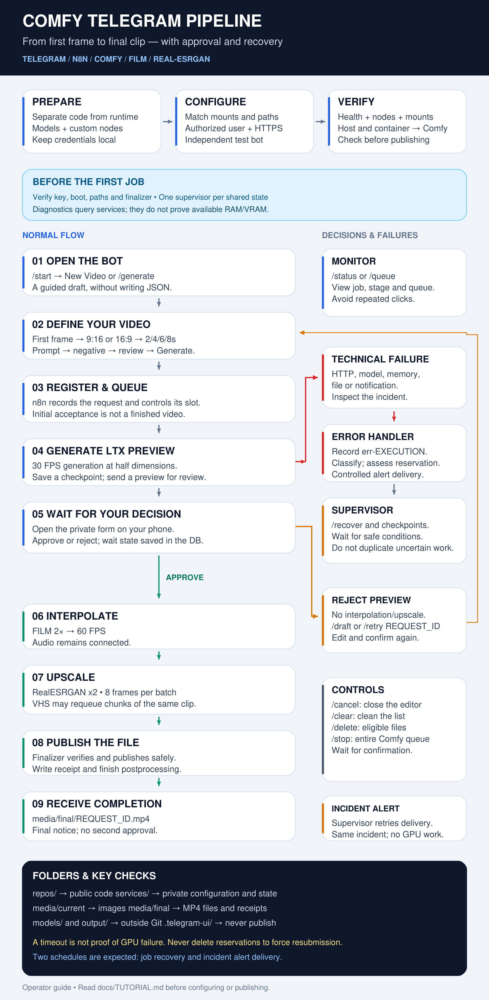

# Complete tutorial — Comfy Telegram Pipeline

From folder preparation to the final video: assisted installation, verification, operation, recovery, and frequently asked questions.

**Audience:** Windows users with Docker Desktop and a working Comfy installation. **Reference:** n8n 2.43.7, Comfy 0.42.3, VideoHelperSuite 1.7.9, and the models in [MODELS.md](MODELS.md). Reference versions are not a promise of future compatibility.

**Validation status:** the author tested the private pipeline. Public templates have undergone review and offline tests. Updated PowerShell scripts still need Windows execution; they were not run in this Linux environment. This guide is not clean-install certification and does not replace a production backup.



Editable vector: [pipeline-flow.svg](assets/pipeline-flow.svg).

## Contents

1. [Understand the architecture](#1-understand-the-architecture)
2. [Recommended folders](#2-recommended-folders)
3. [Prerequisites and security](#3-prerequisites-and-security)
4. [Prepare a local copy automatically](#4-prepare-a-local-copy-automatically)
5. [Configure Comfy](#5-configure-comfy)
6. [Prepare Docker, HTTPS, and credentials](#6-prepare-docker-https-and-credentials)
7. [Import and review workflows](#7-import-and-review-workflows)
8. [Run preflight checks](#8-run-preflight-checks)
9. [Use the bot from start to finish](#9-use-the-bot-from-start-to-finish)
10. [Understand files, names, and recovery](#10-understand-files-names-and-recovery)
11. [Testing and update routine](#11-testing-and-update-routine)
12. [Questions and answers with examples](#12-questions-and-answers-with-examples)

## 1. Understand the architecture

Telegram is the interface. n8n receives choices, organizes the queue, submits requests, and monitors results. Comfy executes models. VideoHelperSuite splits upscale into small batches. Project custom nodes protect submissions and publish final files.

Normal flow: **/generate → image → aspect ratio → duration → prompts → Generate → queue → LTX → preview → approval → interpolation → upscale → finalizer → completion notice**.

Rejecting a preview stops postprocessing for that result. Recover and edit its draft for a new generation. Technical failures follow a different route: persist an incident, retain or release the reservation according to evidence, and evaluate recovery. Rejecting a video's composition is different from a backend failure.

| Component | Responsibility | Boundary |
|---|---|---|
| Bot | Wizard, files, and commands | Does not execute models |
| Main LTX workflow | Generation, approval, postprocessing | Initial acknowledgment is not a completed video |
| Supervisor, 20 nodes | Recovery Schedule and Error Alert Schedule | Never duplicate against the same state |
| Handler, 8 nodes | Incidents, failure policy, alert delivery | Never blindly repeats uncertain submissions |
| Manual Recovery, 4 nodes | Exceptional release of an inspected reservation | Does not resubmit the queue |
| Job Control | Authenticated /health, /submit, /recovery-snapshot, /delete | Does not replace n8n authorization |
| Finalizer | MP4 publication and verified receipt | Does not finalize incomplete batches |

This project's queue **is not n8n distributed queue mode**. It uses local files and locks. Adding replicas or external runners requires reviewing those contracts.

## 2. Recommended folders

Separate public code, private runtime, and models. Prefer SSD storage for media/state. Do not put the database or locks on a network share to share them across machines.

| Example folder | Contents | Git? |
|---|---|---|
| E:/AI/repos/comfy-telegram-pipeline | Repository clone | Public content only |
| E:/AI/services/comfy-pipeline-lab | Generated test runtime | No |
| E:/AI/services/comfy-pipeline-lab/media/current | Received first frames | No |
| E:/AI/services/comfy-pipeline-lab/media/workflows/ltx.json | Installed API input template | Not the configured copy |
| E:/AI/services/comfy-pipeline-lab/media/final | Final MP4 and .done.json | No |
| E:/AI/services/comfy-pipeline-lab/media/.telegram-ui | Key, drafts, jobs, incidents, receipts | No |
| E:/AI/services/comfy-pipeline-lab/deployment | Local workflows, Compose, configured plugins | No |
| E:/AI/apps/ComfyUI-lab | Test Comfy installation | Separate repository/distribution |
| E:/AI/output/comfy-pipeline-lab | Intermediate Comfy renders | No |
| E:/AI/models | Weights organized by category | No |
| E:/AI/backups/comfy-pipeline | Private backups; preferably another off-machine copy too | No |

These names are suggestions. Required mappings are **Windows media ↔ /files** and **Comfy output ↔ /comfy-output**. Comfy output must differ from the media folder. This integration publishes final clips to media/final.

The script creates private folders; it does not install Comfy, download weights, or modify an existing installation. Create the output folder only after choosing the Comfy instance that will use it:

```powershell
New-Item -ItemType Directory -Path 'E:\AI\output\comfy-pipeline-lab' -Force
```

Do not create BaseRoot manually. The preparer requires a nonexistent destination to prevent overwrites.

## 3. Prerequisites and security

From the clone, check:

```powershell
git --version
docker version
docker compose version
node --version
```

The preparer needs Python 3.10+. You may use Comfy's Python. The reference environment is in DEPENDENCIES.md. Check your executable without installing another PyTorch over a working GPU runtime.

```powershell
$ComfyRoot = 'E:\AI\apps\ComfyUI-lab'
$ComfyPython = Join-Path $ComfyRoot '.venv\Scripts\python.exe'
& $ComfyPython --version
```

Adapt this to your distribution. In Desktop installations, main.py and .venv are in the instance's ComfyUI directory, not necessarily beside the Desktop executable.

If downloaded scripts are blocked, review them and unblock only these five project scripts:

```powershell
Unblock-File .\tools\Initialize-Pipeline.ps1
Unblock-File .\tools\Install-PipelineCustomNodes.ps1
Unblock-File .\tools\Test-Pipeline.ps1
Unblock-File .\tools\Test-Repository.ps1
Unblock-File .\tools\Get-TelegramIdentity.ps1
Get-ExecutionPolicy -List
```

If necessary and permitted by machine administration, use RemoteSigned for the current session only. Group Policy may override it; do not disable organizational policy.

```powershell
Set-ExecutionPolicy -Scope Process -ExecutionPolicy RemoteSigned
```

Parallel testing needs **another Telegram bot**, another n8n volume/database, a separate media root, and an independent Comfy instance. Testing the Trigger with the same bot can replace production's webhook.

### Create a bot and discover your ID before preparation

1. Open the official verified BotFather in Telegram and send `/newbot`.
2. Choose a display name and available bot username. Save its token in a password manager, never in support chat or Git.
3. To find your own ID without a third-party bot, run this local helper with the new bot before configuring Telegram Trigger. It requests hidden token input and does not save the token.

```powershell
.\tools\Get-TelegramIdentity.ps1
```

The helper first checks for an existing webhook. If one exists, it stops without deleting it. Never use this procedure to take over production's webhook. Otherwise, it asks you to send a unique `/whoami` challenge to your bot and looks for that private message. Record user_id/chat_id, which match in the supported private conversation.

This is local bootstrap, not production bot polling. Runtime still uses Telegram Trigger and the saved n8n credential. Telegram's API places the token in the internal request URL by design; the helper does not print that URL or raw HTTP errors. Do not enable credential-bearing request tracing/debugging. The wrappers still need real Windows testing.

Optionally register this command list through BotFather's `/setcommands`:

```text
start - Open menu
generate - Create video
draft - Resume draft
retry - Recover job parameters
status - Show jobs
queue - Show queue
cancel - Close draft editor
clear - Clear drafts and closed-job list
delete - Delete eligible draft
recover - Recover queue
stop - Stop all jobs
help - Help
```

Registering commands does not implement them; the published workflow does. This project supports private chat, not a shared group bot.

## 4. Prepare a local copy automatically

### 4.1 What preparation does

- Copies five regular workflows as inactive .local.json files.
- Updates authorized ID, request_id prefixes, job globs, and draft paths consistently.
- Configures Windows roots, Comfy URL, and private form base.
- Creates configured copies of both plugins and installs the private LTX template.
- Generates lab Compose with persistent project data, filesystem binary storage, and read-only Comfy output.
- Separates the T5 fixture without publishing it.
- Does not generate tokens, select n8n credentials, open firewall rules, or start services.

This avoids manually replacing user settings in every Code block. Public templates retain inert placeholders. Credentials remain in n8n, never in templates.

### 4.2 Run preparation

Use your numeric private-chat user ID, not your username, bot ID, or bot token. URLs must be your actual planned HTTPS proxy endpoints. They are not passwords, but belong in the private deployment copy.

```powershell
$BaseRoot = 'E:\AI\services\comfy-pipeline-lab'
$ComfyRoot = 'E:\AI\apps\ComfyUI-lab'
$ComfyOutput = 'E:\AI\output\comfy-pipeline-lab'
$ComfyPython = Join-Path $ComfyRoot '.venv\Scripts\python.exe'
$TelegramUserId = Read-Host 'Your numeric Telegram private-chat user ID'
$PrivateBaseUrl = Read-Host 'Private HTTPS base for the UI and forms'
$PublicWebhookBaseUrl = Read-Host 'Public HTTPS base dedicated to Telegram webhooks'

.\tools\Initialize-Pipeline.ps1 `
    -BaseRoot $BaseRoot `
    -TelegramUserId $TelegramUserId `
    -ComfyOutputRoot $ComfyOutput `
    -PrivateBaseUrl $PrivateBaseUrl `
    -PublicWebhookBaseUrl $PublicWebhookBaseUrl `
    -PythonPath $ComfyPython `
    -N8nHostPort 5681
```

For another backend port, add `-ComfyContainerUrl 'http://host.docker.internal:PORT'`. This configures callers, not the backend listening port.

**Expected:** five files under deployment/workflows, two configured plugins, and media/workflows/ltx.json. Existing BaseRoot or a target within the clone is refused. For another trial, choose a new name; never delete production to satisfy the script.

URLs must use HTTPS with no path, query, username/password, or .invalid domain. Telegram accepts public webhook ports 443, 80, 88, and 8443; normally use 443 or 8443 with valid TLS. Embedded URL tokens are refused. Chat/user are configured for the same person's private conversation; groups are unvalidated.

### 4.3 Review without exposing secrets

```powershell
Get-ChildItem (Join-Path $BaseRoot 'deployment\workflows') -Filter '*.local.json'
Test-Path (Join-Path $BaseRoot 'media\workflows\ltx.json')
Get-Content (Join-Path $BaseRoot 'deployment\BEFORE-START.txt') -Encoding UTF8
```

settings.local.json contains local settings without tokens. That does not make it public: keep the deployment directory outside Git.

## 5. Configure Comfy

Install Comfy and weights using vendor guidance and [MODELS.md](MODELS.md). Use the correct AMD/ROCm or NVIDIA distribution. This tutorial does not replace your GPU runtime or automatically install generic PyTorch wheels.

Math, selector, FILM, and video nodes are native in the inventoried version. Install VideoHelperSuite v1.7.9 through the appropriate Manager version and confirm VHS_LoadVideoPath exists. AnimateDiff, Easy Use, KJNodes, and rgthree are unnecessary for these graphs.

Preview plugin installation:

```powershell
.\tools\Install-PipelineCustomNodes.ps1 `
    -PreparedRoot $BaseRoot -ComfyRoot $ComfyRoot -WhatIf
```

After reviewing the result:

```powershell
.\tools\Install-PipelineCustomNodes.ps1 `
    -PreparedRoot $BaseRoot -ComfyRoot $ComfyRoot
```

The installer refuses existing plugin folders; it is not a production updater. Failure during the second copy can leave the first installed. Check before retrying; the script does not remove an existing destination.

Start the selected Comfy instance with `$ComfyOutput`. Use your distribution's supported startup method. Console example for an already configured Python/model environment:

```powershell
Push-Location $ComfyRoot
try {
    & $ComfyPython -s .\main.py `
        --port 8188 `
        --output-directory $ComfyOutput
}
finally {
    Pop-Location
}
```

Include required extra-model-paths and optimization arguments from your installation. This minimal command does not reproduce every previous Desktop flag. It occupies the terminal. To survive SSH disconnection, configure and validate a separate scheduled task/service; do not assume a foreground process persists.

Check both plugin imports. Job Control should create media/.telegram-ui/comfy-control.key and comfy-boot.json. Preserve the external key across starts instead of generating another one each time.

## 6. Prepare Docker, HTTPS, and credentials

### 6.1 Lab Compose

The preparer writes deployment/compose.local.yaml as JSON, which is valid YAML. Manual reformatting is unnecessary.

It uses n8n 2.43.7, host loopback port 5681 → container 5678, writable /files, read-only /comfy-output, and a project-specific persistent volume. Changing Compose project names can create a different database volume.

Review configuration before starting:

```powershell
$Compose = Join-Path $BaseRoot 'deployment\compose.local.yaml'
docker compose -p comfy-pipeline-lab -f $Compose config --quiet
```

Before `up`, configure the **actual** trusted-proxy count (N8N_PROXY_HOPS) and HTTPS forwarding. Compose creates no proxy, DNS, certificate, Tailscale, or Funnel rules. It is a lab reference, not an audited production security profile.

Check for an existing project:

```powershell
docker compose ls
```

If comfy-pipeline-lab belongs to another trial, do not apply a new Compose file over it. Return to that prepared root, or choose another project name consistently, including diagnostics. Use the same name to resume the same lab.

```powershell
docker compose -p comfy-pipeline-lab -f $Compose up -d
docker compose -p comfy-pipeline-lab -f $Compose ps
```

Existing operators do not need another container merely to update documentation. A second supervisor against the same media is incorrect even if its container appears isolated.

The reference uses internal runners, not a universal isolation recommendation. Only fs is allowed, but file-node access restrictions do not globally sandbox fs. Import trusted workflows only and restrict Code editing. External-runner migration requires reviewing /proc, mounts, and locks.

### 6.2 HTTPS and public/private paths

Configure two proxy surfaces:

- Private HTTPS: UI and forms reachable by phone through Tailscale.
- Public HTTPS: only this installation's Telegram Trigger POST route.

Port 5681 binds to 127.0.0.1 for the host proxy. Never expose Comfy publicly.

N8N_WEBHOOK_URL uses the public base. N8N_EDITOR_BASE_URL and review links use the private base. Forward appropriate headers and configure actual proxy hops; Tailscale plus Nginx may differ from a single-proxy setup.

After import, copy Telegram Trigger's **Production URL** and allow only that exact path/method publicly. This installation must generate its own webhookId. If import fails to generate one, recreate only Telegram Trigger, reconnect it to the first authorization node, and retain message plus callback_query. Do not reuse production endpoint IDs.

Native upstream Trigger code registers/verifies secret_token for node versions above 1; templates use 1.2. Confirm installed behavior and preserve X-Telegram-Bot-Api-Secret-Token through the proxy. Do not manually replace setWebhook and lose the secret. Body IDs are additional authorization, not a substitute for origin verification.

Do not expose /webhook/start, /webhook/video-queue-reconcile, /form-waiting, the UI, or /n8n/jobs/* through the bot's public surface. Approval uses the private surface. A matching user ID in JSON does not prove a public POST came from Telegram.

### 6.3 n8n credentials

| Credential / role | Configuration | Nodes |
|---|---|---|
| Telegram | Installation bot token in native credential | Trigger, messages, callbacks, downloads across all workflows |
| LTX Start Auth | Header Auth: Name X-LTX-Token, locally random Value | Receive Request; Start Video Workflow; Resume Video Workflow |
| Comfy Job Control | Shared key file; expressions already present | Bearer for /n8n/jobs/*; X-N8N-Recovery-Key for wake/resume |

Generate Header Auth with a local password tool. Alternatively, copy a cryptographic random value to the clipboard without printing it, paste into n8n's Value, then clear the clipboard. Do not replace the Job Control key with this value.

```powershell
$randomBytes = New-Object byte[] 32
$rng = [System.Security.Cryptography.RandomNumberGenerator]::Create()
try {
    $rng.GetBytes($randomBytes)
    $headerSecret = [Convert]::ToBase64String($randomBytes)
    Set-Clipboard -Value $headerSecret
}
finally {
    $rng.Dispose()
    [Array]::Clear($randomBytes, 0, $randomBytes.Length)
    Remove-Variable headerSecret -ErrorAction SilentlyContinue
}
```

Other apps and clipboard history/sync may access clipboard content. Prefer a password manager if that is unsuitable. After pasting:

```powershell
Set-Clipboard -Value ''
```

Do not share full docker inspect output, .env, databases, or credential exports for support; they may expose secrets.

## 7. Import and review workflows

Import **deployment/workflows/*.local.json**, not ID-zero public templates. Suggested order: handler → main → supervisor → bot → manual. Keep everything unpublished until configuration is complete.

1. Select Telegram credentials on every Telegram node; Trigger selection is not inherited.
2. Configure Receive Request with Header Auth / LTX Start Auth.
3. Select Generic Credential Type → Header Auth → the same credential in Start Video Workflow and Resume Video Workflow.
4. Preserve X-N8N-Recovery-Key on Resume Video Workflow in addition to Header Auth.
5. Select the imported handler in Settings → Error Workflow for main, bot, and supervisor; never bind the handler to itself.
6. Review Initialize Post Processing's windows_output_root and telegram_chat_id. Preparation updates them, but the root must match your actual instance.
7. Check Read Workflow LTX: /files/workflows/ltx.json.
8. Check Send Review Link: private base, no double slash before form-waiting, signature/query preserved.
9. Enable message and callback_query in Trigger; do not filter callbacks out.
10. Check supervisor's 20 nodes, including Error Alert Schedule → Reconcile Error Incidents → Claim Error Notice → Error Notice Required? → Notify Error Retry → Acknowledge Error Notice.

Error Trigger does not require publication as a scheduler. Manual Recovery and T5 are outside normal automatic operation. Renaming nodes without updating expressions can break name-based references.

## 8. Run preflight checks

On Windows, without submitting GPU work:

```powershell
.\tools\Test-Pipeline.ps1 -PreparedRoot $BaseRoot
```

For another local Comfy port:

```powershell
.\tools\Test-Pipeline.ps1 `
    -PreparedRoot $BaseRoot -ComfyHostUrl 'http://127.0.0.1:8189'
```

Also check **container → host** while the lab container is running:

```powershell
.\tools\Test-Pipeline.ps1 `
    -PreparedRoot $BaseRoot -CheckDocker -ProjectName comfy-pipeline-lab
```

Diagnostics read queue, health, node inventory, and mount existence. They do not submit prompts, interrupt tasks, print keys, or change reservations. Health does not prove sufficient RAM/VRAM, every weight's availability, or all file write permissions.

Expected: queue_ok/health_ok/protocol_ok/finalizer_ok/aspect_ok/shared_root_matches/output_root_matches/boot_matches true; missing_nodes empty; container_queue_status/container_health_status 200 when requested.

Before publishing schedules, test runner fs and /proc access in a temporary, disconnected Code node:

```javascript
const fs = require('fs');
const marker = '/files/.pipeline-runner-probe-' + $execution.id;
let created = false;
try {
  const boot = fs.readFileSync('/proc/sys/kernel/random/boot_id', 'utf8').trim();
  const stat = fs.readFileSync('/proc/1/stat', 'utf8');
  fs.writeFileSync(marker, 'probe', { flag: 'wx', mode: 0o600 });
  created = true;
  const writable = fs.readFileSync(marker, 'utf8') === 'probe';
  return [{ json: { writable, proc_readable: !!boot && !!stat } }];
} finally {
  if (created && fs.existsSync(marker)) fs.unlinkSync(marker);
}
```

If it fails, fix the executor/mounts. Do not allow all modules with `*` or disable protections as a shortcut. The probe creates/removes only its unique marker; restrict the editor to trusted administrators.

After checks, publish **main → supervisor → bot**. Keep Manual Recovery/T5 disabled. Supervisor publication starts schedules immediately, so review roots/state first.

## 9. Use the bot from start to finish

### 9.1 Create a draft

1. Send `/start` to open the menu.
2. Tap New Video or send `/generate` alone.
3. Send one JPG/PNG/WebP image per message, up to 12 MiB. Prefer **File/Document** to preserve quality; Telegram photos may be compressed.
4. Choose 9:16 or 16:9. The selector stays at 2 MP.
5. Choose 2, 4, 6, or 8 seconds. Some API validators accept 10s, but the current wizard and Generate action do not; do not advertise a 10s bot option.
6. Send the prompt as plain text. An image caption can supply it according to the flow. Limits: prompt 3000 characters; negative prompt 1000.
7. Choose the default negative, an empty one, or your own text.
8. Review the draft. Adjust image, format, duration, or text as needed.
9. Tap Generate once and wait for job registration.

Plain-text prompt example:

```text
Slow camera push-in. The objects remain stationary. Preserve the subject,
lighting and proportions. One continuous shot, no cuts or scene transition.
```

### 9.2 Monitor

Use `/status` or `/queue`. Registered jobs may wait for stage availability. The bot can admit several requests while the scheduler controls execution; this does not mean simultaneous video models on the GPU.

Avoid repeated Generate taps when responses are slow. For uncertain submissions, inspect status and use the bot's reconciliation path for the same request.

| Aspect ratio | Generation at half dimensions | New-job output |
|---|---|---|
| 9:16 | 544x960, 30 FPS | 1088x1920, 60 FPS |
| 16:9 | 960x544, 30 FPS | 1920x1088, 60 FPS |

2 MP and Full HD are presentation approximations; the table gives exact dimensions. Frame alignment may slightly change duration.

### 9.3 Approve or reject

After LTX, receive the preview/review link. Open it on a phone with private-network access, select Approve or Reject, and submit the form. Do not share the signed link: it permits deciding that execution.

- **Approve:** proceeds directly to interpolation and upscale without another approval.
- **Reject:** skips postprocessing for that result; recover via /draft or /retry REQUEST_ID, edit, and explicitly confirm a new generation.

Wait persists the pause in the database rather than running a GPU loop. Database persistence/availability remains necessary. Do not configure a short global execution timeout assuming approval always comes within minutes.

### 9.4 Postprocessing and completion

FILM increases frames to 60 FPS. RealESRGAN x2 upscales in batches of 8, with audio connected and a final aspect-specific resize. VHS may requeue chunks; a batch is not a new user-requested video.

The finalizer receives filenames, selects the completed MP4 for that job, copies with a bounded buffer, verifies content, publishes without overwriting different content, and records a receipt. Only afterward does it remove the completed source. Pending batches return without publishing an empty file.

Expected destination: **media/final/REQUEST_ID.mp4**. The completion message requires no second approval and does not need to send the entire final clip through Telegram.

## 10. Understand files, names, and recovery

| Identifier | Meaning |
|---|---|
| request_id | Logical request identity, e.g. tg-ID-UPDATE |
| execution_id | Current n8n execution |
| postprocess_run_id | REQUEST_ID-eEXECUTION_ID, binding intermediates to an execution |
| prompt_id | Comfy submission identity |
| err-EXECUTION_ID | Error Handler incident |

Unconfirmed drafts may have temporary names. Confirmed jobs and final clips use request_id. Do not rename intermediates while jobs are active: checkpoints/validation depend on paths.

### Command scope

| Command | Effect |
|---|---|
| /start, /menu | Open menu |
| /generate | Start a wizard without JSON |
| /draft | Open current draft |
| /retry REQUEST_ID | Recover parameters/submission checks; generation still requires confirmation |
| /status, /queue | Show jobs/queue |
| /cancel | Close editing; does not cancel GPU work or delete history |
| /clear | Clear drafts and remove closed jobs from the list; preserve files and active jobs |
| /delete | Delete eligible open draft/exclusive files; preserve final folder and shared files |
| /recover | Reconcile queue/checkpoints while preserving approval requirements |
| /stop | Cancel open jobs and interrupt/clear the entire Comfy queue; preserve files |

`/stop` may affect unrelated manual work on the same Comfy instance. Use a dedicated instance and wait for final confirmation, not just the initial “Stop requested” reply.

### Recovery after an outage

The supervisor may wait for an empty Comfy queue before rebuilding its plan. Confirmation can require multiple observations, and schedules run every minute; recovery is not guaranteed instantly.

A valid checkpoint may allow stage resumption. Incomplete generation may require regeneration. Pending approval stays pending. Preserve the saved seed when reproducing a request. Planned resubmission dispatches one request per cycle rather than the entire queue at once.

Never delete control.json, locks, or receipts to force a reset without understanding state. An HTTP timeout does not prove Comfy rejected or stopped work. The submission endpoint records results and blocks automatic repetition when acceptance is uncertain.

### Current monitoring intervals

Check Wait Unit=Seconds in imported nodes. These are polling intervals, not GPU-runtime estimates.

| Control | Current setting |
|---|---|
| Wait LTX | 90 seconds |
| Wait Interpolation | 30 seconds |
| Wait Upscale | 90 seconds |
| History HTTP | 30-second timeout per query |
| History unavailability | Up to 6 consecutive failures or 5 minutes offline, evaluated at the next query |
| LTX monitoring limit | 24 hours |
| Interpolation monitoring limit | 20 minutes, configurable in Initialize Post Processing |
| Upscale monitoring limit | 90 minutes, configurable there |
| Recovery Schedule / Error Alert Schedule | Each every minute |

A recoverable isolated GET failure keeps prompt_id and returns to Wait. Exceeding a monitoring deadline neither kills Comfy nor proves rejection. Fix authentication/validation errors rather than masking them with indefinite retries.

### Incidents and messages

The handler classifies errors and persists JSON under media/.telegram-ui/scheduler/incidents. It attempts immediate notification; Error Alert Schedule retries Telegram failures up to five total attempts, with 1, 5, 15, and 60-minute delays plus the next scheduler tick. An interrupted claim may wait for its five-minute lease.

Confirmed delivery becomes sent; persistent failure may become attention. Telegram delivery is not exactly once: a lost acknowledgment may repeat the same incident message. That never authorizes another GPU generation.

The persistent outbox covers incident alerts. Do not assume normal bot replies, previews, or final notifications have the same delivery guarantees.

## 11. Testing and update routine

### Offline tests without GPU

The wrapper first parses scripts with PowerShell's parser, then runs Node/Python checks:

```powershell
.\tools\Test-Repository.ps1 -PythonPath $ComfyPython
```

Or run tests separately:

```powershell
node .\tools\export-runtime-graphs.cjs
& $ComfyPython -B .\tests\test_custom_node_contracts.py
& $ComfyPython -B .\tests\test_local_configuration.py
```

The exporter deterministically rewrites public examples. Configuration tests use temporary directories, verify unchanged sources/correlated substitutions, and compile generated Code blocks when Node is available. Finalizer tests use dummy bytes; they do not validate model-produced MP4 quality.

### Suggested live tests

| Test | Procedure | Acceptance |
|---|---|---|
| T0 | Host/Docker diagnostics and runner probe | Correct paths, key, boot, nodes, access |
| T1 | One 2s 9:16 video; approve | Interpolation, upscale, final file, notice |
| T2 | Reject, recover draft, edit | No rejected-result postprocessing; user confirms new request |
| T3 | Two requests, then 16:9 | Coherent order and correct final dimensions |
| T4 | Controlled /stop | Confirmed stop, empty queue, no resurrection |
| T5 | Configured controlled-failure fixture in isolation | Intentional HTTP400, incident, rejected reservation released, no sampling |
| T6 | Isolated incident-message failure | Supervisor delivers the same incident without GPU resubmission |

For local T5, select the same Header Auth and handler; temporarily publish its separate start-t5 path. Initial webhook ACK is not the expected failure. Queue LTX fails when submitting T5_IntentionallyMissingNode. Unpublish afterward.

For T6, with an empty isolated queue, temporarily set Notify Failure → Text to `{{ '' }}`. Trigger one automatic T5, let the handler process the empty-message error, then restore `{{ $json.message }}`. Leave Notify Error Retry unchanged. Later delivery must reference the same incident; inspect supervisor ACK and persisted state. Do not run this against a production bot full of jobs.

### Updates and Git

Before updating production, control the queue, record the current version, save private exports, and make a consistent backup of n8n, encryption key, media state, and referenced videos. Copying an active SQLite database's files can be inconsistent; use a proper backup mechanism or a controlled service-stop window.

Never use `docker compose down -v` for routine updates: it may delete persistent volumes. Do not regenerate keys or change Compose project names without understanding which volume will open.

For public documentation/code:

```powershell
git status --short --untracked-files=all
git diff --check
git diff --cached --name-only
```

Stage explicitly. Scan content and history for secrets before publication; scanners cannot recognize every custom secret. VHS may embed workflow metadata in videos. Review prompts/paths before sharing support media. Never publish private logs/media without reviewing them.

## 12. Questions and answers with examples

### 1. Can I import public templates and publish immediately?

No. They have no credentials and use inert placeholders. Prepare local copies, import .local.json, and configure credentials, handler bindings, and HTTPS first.

**Example:** import `E:/AI/services/comfy-pipeline-lab/deployment/workflows/telegram-bot.local.json`, not `workflows/telegram-bot.template.json`.

### 2. Preparation refuses an existing folder. Can I use Force?

There is no Force option. Refusal protects existing state/customizations. The preparer creates new deployments; it does not update configured production.

**Example:** use `-BaseRoot 'E:\AI\services\comfy-pipeline-lab-02'` for another trial, with separate bot, volume, and backend if running concurrently.

### 3. Why is /generate followed by JSON rejected?

The current wizard accepts the command alone, then inputs at each step. Prompt spaces and newlines are ordinary text and need no JSON escaping in this flow.

**Example:** send `/generate`, send the image, choose format/duration, then send `Slow camera push-in. Preserve the scene.` as a message.

### 4. Commands work, but buttons keep loading. What should I check?

Enable callback_query in Telegram Trigger and check filters that might discard it. Callbacks also pass authorization and Answer Button Click. An old button may be rejected by state-revision checks; open a fresh menu.

**Example:** enable both `message` and `callback_query`, publish, send `/start`, and tap a new button. Check whether it creates an execution.

### 5. Why did the bot stop receiving events after a manual test?

The test may have replaced production's webhook for the same bot. Telegram delivers only to its currently registered webhook. Use a different bot for the lab.

**Example:** stop the test listener and republish the correct workflow; next time use another bot credential.

### 6. The form opens on the PC but returns 404 on my phone.

Check the private base, phone Tailscale access, form-waiting path, and signed query. An old/completed execution is different from a pending form. Editor test URLs are not production URLs.

**Example:** fix `//form-waiting/` construction in Send Review Link, preserve the signature, and test a fresh approval with Tailscale connected.

### 7. Must approval forms be public through Funnel?

Not in this design. Public access receives Telegram POSTs; the operator approves through the private base. The phone needs access to that private network.

**Example:** allow only the exact Telegram Trigger path publicly and open the review link with Tailscale connected.

### 8. Upload Image returned ECONNREFUSED. Is my image wrong?

That code indicates TCP connection failure before the upload is processed. Check backend process, port, listening interface, and container-to-host connectivity. The image may be valid.

**Example:** run `Test-Pipeline.ps1 -PreparedRoot $BaseRoot -CheckDocker`. If host works and container fails, investigate Docker/network access next.

### 9. Why does the API work on Windows but fail inside Docker?

Container 127.0.0.1 refers to the container itself. Docker Desktop reaches the host through host.docker.internal. Check firewall/binding; a host-only test does not validate that route.

**Example:** use `http://host.docker.internal:8188` for host Comfy, and `http://127.0.0.1:5678/webhook/start` for bot-to-main calls within the same n8n container.

### 10. Which key should I check for 401 or 403?

It depends on the route. /webhook/start requires Header Auth X-LTX-Token; /n8n/jobs/* uses the shared-file Bearer; wake/resume also uses X-N8N-Recovery-Key. An intermediate proxy can also return 403.

**Example:** for 401 on Resume Video Workflow, check LTX Start Auth while retaining X-N8N-Recovery-Key. Do not randomly replace Comfy's key.

### 11. Does 404 or 405 on /n8n/jobs mean the plugin is missing?

Check HTTP method and plugin loading on the actual instance/port. /health uses GET; /submit, /delete, and /recovery-snapshot use POST. Another instance's UI response is not evidence about this endpoint.

**Example:** authenticated GET /n8n/jobs/health returns protocol information. POST to /health may return 405 even when installed.

### 12. Why is /comfy-output/video\\n8n\\... missing?

Windows separators were mixed with a Linux path. n8n must use its Linux mount and normalize subfolder separators to '/'. Verify the bind points to actual Comfy output too.

**Example:** `/comfy-output/video/n8n/REQUEST_ID/ltx_00001_.mp4` is a container path; `C:\...\output\video\n8n\...` is not a valid Linux fileSelector.

### 13. What causes Module fs is disallowed or /proc read errors?

The Code executor lacks permission or the expected filesystem context. Allow fs in the actual runtime and run the probe. A host script cannot validate runner-specific access.

**Example:** for external runners, allowing fs only in the main container is insufficient. Review runner configuration and lock identity without allowing every module through `*`.

### 14. Files are mounted, but the read node rejects the path.

Mount existence and file-node policy are separate checks. Configure n8n 2.x file-access allowlists and appropriate container-user permissions.

**Example:** set `N8N_RESTRICT_FILE_ACCESS_TO=/files;/comfy-output`; keep /files writable and /comfy-output read-only.

### 15. Missing node type: Save Video. Should I install a SaveVideo plugin?

SaveVideo is native in the inventoried environment. Check version and object_info before installing by name. In T5, the title is Save Video but class_type is intentionally fictitious.

**Example:** `T5_IntentionallyMissingNode` at node 75 is the expected rejection test, not a reason to modify the main workflow.

### 16. Why can a loader not find a model that exists on disk?

Check folder category, exact filename, and extra-model-paths for the instance that received the request. Similar filenames or HTML saved as a model are not equivalent weights.

**Example:** VAELoader must list `ltx-2.5-video-vae-conv-bf16.safetensors`; `...video-vae-bf16...` is another variant, not a spelling fix.

### 17. Will the pipeline fail if ffmpeg is absent from PATH?

PATH alone cannot determine that. A distribution may use PyAV encoders and/or an executable supplied by dependencies. Inspect actual Python environment/logs before installing another package.

**Example:** `& $ComfyPython -c "import av; print(av.__version__)"` checks PyAV availability but does not replace a real backend save test.

### 18. Why is generation small when I selected 2 MP?

The selector establishes base dimensions, then math nodes halve both for generation. Approved results are enlarged later, reducing LTX load.

**Example:** 9:16 selects 1088x1920, generates 544x960 at 30 FPS, and delivers 1088x1920 at 60 FPS.

### 19. Can I select 10 seconds in the bot?

Not in this wizard. Buttons and Generate accept 2/4/6/8. Some API/recovery validators accept 10, but that is neither complete UI support nor proof the hardware can handle it.

**Example:** start with 2s, then use 4/6/8. Adding 10s requires consistent interface changes and testing.

### 20. Upscale requeues many times. Is that an infinite loop?

VHS Meta Batch may requeue to consume the next frame group and finish combining. Follow progress, files, and stage; each requeue is not a new request.

**Example:** frames_per_batch=8 creates many batches per clip. Only N8NMoveFinalVideo should publish the completed MP4 and receipt.

### 21. Does a loud CPU fan prove the GPU is unused?

No. Decoding, reading, encoding, copying, and offloading also consume CPU/RAM/disk. Compare logs, dedicated GPU memory, compute metrics, and active stage. Transfers/paging may be the bottleneck.

**Example:** high CPU and low VRAM during encoding after upscale do not prove ImageUpscaleWithModel ran entirely on CPU.

### 22. Does a timeout prove Comfy ran out of RAM?

No. A busy backend, network, disk, process pauses, or memory pressure can cause timeouts. The code alone cannot identify the cause. Do not resubmit uncertain generation before checking state.

**Example:** Get Interpolation History ECONNABORTED may be handled by bounded polling; inspect prompt_id and queue before /recover.

### 23. How do I resume after the PC restarts?

Start the correct services with the same persistent state; check health and /status. The supervisor or /recover inspects checkpoints and may wait for Comfy to become idle. An incomplete checkpoint is not automatically a finished result.

**Example:** saved interpolation plus recorded approval may allow upscale recovery. A job awaiting approval must still wait for your decision.

### 24. /recover is not immediate. Should I repeat it?

Do not repeat simply because it is slow. Recovery can wait for existing tasks, collect empty-queue observations, and dispatch per cycle. More commands cannot shorten GPU work.

**Example:** if /status reports an executing task, monitor that job rather than starting another manual recovery.

### 25. Queue paused, Comfy empty: can I delete control.json?

No. A reservation may represent unconfirmed submission or unreconciled state. Inspect the incident, execution, and recovery. Deleting state destroys useful evidence.

**Example:** submission_uncertain needs reconciliation. Manual Recovery refuses inflight work and is not a general reset.

### 26. How do /retry, /recover, and /cancel differ?

/retry restores a request's parameters/checks and waits for confirmation; /recover reconciles the persistent queue; /cancel closes draft editing only. None means delete a final video.

**Example:** rejected composition: `/retry REQUEST_ID` → edit prompt → Generate. Service outage with pending queue: `/status` → `/recover` when appropriate.

### 27. Did /clear delete my final clip?

Under the current contract, no. It clears drafts and removes closed jobs from the list while preserving files and active jobs. Removing a list entry is different from deleting its MP4.

**Example:** after /clear, look for `media/final/REQUEST_ID.mp4` if the job had completed.

### 28. How do I delete a rejected draft, and why was /delete refused?

Open the corresponding draft and use /delete. Active jobs, pending submissions, superseded state, and busy Comfy are legitimate refusal reasons. Final files and shared images are preserved.

**Example:** `/retry REQUEST_ID` → restore draft → `/delete` → confirmation. Do not kill active work merely to bypass deletion checks.

### 29. /stop acknowledged the request, but a task remains. Is that an error?

The first message acknowledges the request. Stop then verifies and confirms completion. It affects the entire Comfy queue and prevents later stages for cancelled jobs.

**Example:** wait for “Stop confirmed” before submitting another job. /cancel is not a GPU interrupt alternative.

### 30. No failure alert arrived. Where should I look?

Check the handler execution, persisted incident, and updated supervisor's Error Alert Schedule route. Verify Telegram credentials in Notify Failure and Notify Error Retry. State may be pending, sending, sent, or attention.

**Example:** an ACK with incident_id `err-123` and notification_state `sent` records confirmation. A supervisor without Error Alert Schedule is not the current 20-node structure.

### 31. Is the supervisor broken because it runs twice per minute?

It has two independent triggers: job recovery and incident alert delivery. Periodic runs with no queue change are expected; repeated “recovery complete” messages are a separate problem to investigate.

**Example:** inspect the initiating trigger. Error Alert Schedule must not resubmit a GPU job.

### 32. Did duplicate alerts mean duplicate video generation?

Not necessarily. A message acknowledgment may be lost. The outbox bounds retries but cannot guarantee exactly-once delivery. Compare incident_id, request_id, and prompt_id first.

**Example:** two `err-123` messages may reflect one failure and a delivery retry, with only one recorded submission.

### 33. The final video exists, but notification failed. Should I generate again?

Check file, receipt, and status first. A messaging failure after completion does not prove the video is lost. Avoid repeating expensive work because of Telegram.

**Example:** if `media/final/REQUEST_ID.mp4` and its receipt are valid, inspect Notify Finished and credentials before Generate.

### 34. Can I remove a finalizer lock or bypass overwrite refusal?

The finalizer protects against content collisions and concurrent publication. Verify no worker still owns the destination and inspect logs/receipts before manual intervention. Deleting every .move.lock by default is unsafe.

**Example:** “Destination already exists with different content” requires comparing files/job identity. Renaming request_id externally does not satisfy the contract.

### 35. Can I approve hours later?

Wait uses database persistence. Resumption needs the preserved database/files. It cannot survive deleted volumes, wrong encryption keys, inappropriate execution pruning, or an already cancelled execution by promise alone.

**Example:** closing Telegram does not cancel approval; `docker compose down -v` may destroy the required state.

### 36. What causes Telegram's “can't parse entities” error?

Dynamic text may be parsed as malformed Markdown/HTML. Templates use HTML in several nodes and escape relevant messages. Check manual Parse Mode/text changes first.

**Example:** underscores in an unescaped Markdown filename can break a reply. Use plain text for a simple response, or escape for the chosen mode.

### 37. Must I enable something in BotFather for buttons?

BotFather's command menu makes commands discoverable. Inline buttons come from the workflow. Callback handling depends on Trigger and response routes, not just registered commands.

**Example:** registering /retry in BotFather does not implement recovery; its handler must exist in the published n8n workflow.

### 38. Can I send photos, albums, or large files?

The wizard expects one JPG/PNG/WebP image per message, up to 12 MiB. Albums, GIF, HEIC, and multiple files are outside this documented contract. Sending as a file reduces app conversions.

**Example:** convert HEIC locally to PNG/JPG before sending; merely renaming the extension does not convert it.

### 39. How do I check the key without sharing it?

Compare roots/boot and query health through diagnostics using the local key file. Never paste the key into chat/screenshots or regenerate it because you tested the wrong instance.

**Example:** `Test-Pipeline.ps1 -PreparedRoot $BaseRoot -CheckDocker` checks host/container without printing the Bearer.

### 40. A secret scan passed. Can I upload any folder now?

No. Pattern-based scanners do not understand every secret or personal-data purpose. Review staged files; exclude runtime, volumes, media, and credentials. .gitignore does not untrack committed files.

**Example:** `git diff --cached --name-only` should show public code/docs, never settings.local.json, comfy-control.key, or an n8n database.

### 41. Can I replace my existing deployment with the lab Compose file?

It targets a new installation and has not been validated as a drop-in replacement for private production. Volume, port, runner, and proxy changes can break deployment. Migrate separately with backup/testing.

**Example:** preparing comfy-pipeline-lab under another root does not update your existing n8n container or Comfy service.

### 42. How can I ask for help without exposing credentials?

Provide stage, node, HTTP code, masked request/execution IDs when useful, and a diagnostic summary. Job IDs may contain your Telegram ID. Never share databases, keys, full payloads, or signed approval links.

**Example:** “Get Interpolation History, ECONNABORTED, host health OK, container health failed, job ID masked” is more useful than full docker inspect output.

### 43. Why is n8n asking me to create an account when I already had one?

A new instance using another volume has a new database. Check Compose project/volume before assuming data loss. Do not experimentally import an old database with a different encryption key.

**Example:** starting comfy-pipeline-lab does not open production's n8n volume; onboarding is expected for a new lab.

### 44. Should I disable secure cookies to open n8n over HTTP?

First use the configured private HTTPS base and check proxy forwarding. Disabling secure cookies should not become the default for remote login. Container-local HTTP and browser-facing HTTPS have different roles.

**Example:** the proxy accepts HTTPS and forwards locally to 127.0.0.1:5681. Open the private HTTPS URL rather than a network-exposed HTTP IP.

## References and next steps

- [Technical setup](SETUP.md)
- [Verified dependencies](DEPENDENCIES.md)
- [Model sources](MODELS.md)
- [Project review](PROJECT-REVIEW.md)
- [n8n Docker](https://docs.n8n.io/deploy/host-n8n/install-options/install-with-docker)
- [n8n modules](https://docs.n8n.io/deploy/host-n8n/configure-n8n/basic-configuration/configuration-examples/enable-modules-in-code-node)
- [n8n reverse proxy](https://docs.n8n.io/deploy/host-n8n/configure-n8n/basic-configuration/configuration-examples/configure-webhook-urls-with-reverse-proxy)
- [n8n Telegram](https://docs.n8n.io/integrations/builtin/trigger-nodes/n8n-nodes-base.telegramtrigger/common-issues)
- [n8n Wait](https://docs.n8n.io/integrations/builtin/core-nodes/n8n-nodes-base.wait)
- [Telegram Bot API: ports/secret_token](https://core.telegram.org/bots/api#setwebhook)
- [Upstream Telegram Trigger](https://github.com/n8n-io/n8n/blob/master/packages/nodes-base/nodes/Telegram/TelegramTrigger.node.ts)
- [VideoHelperSuite](https://github.com/Kosinkadink/ComfyUI-VideoHelperSuite)

Selecting a code license and implementing CI/CD remain separate tasks. This tutorial chooses no license automatically and enables no deployment pipeline.
